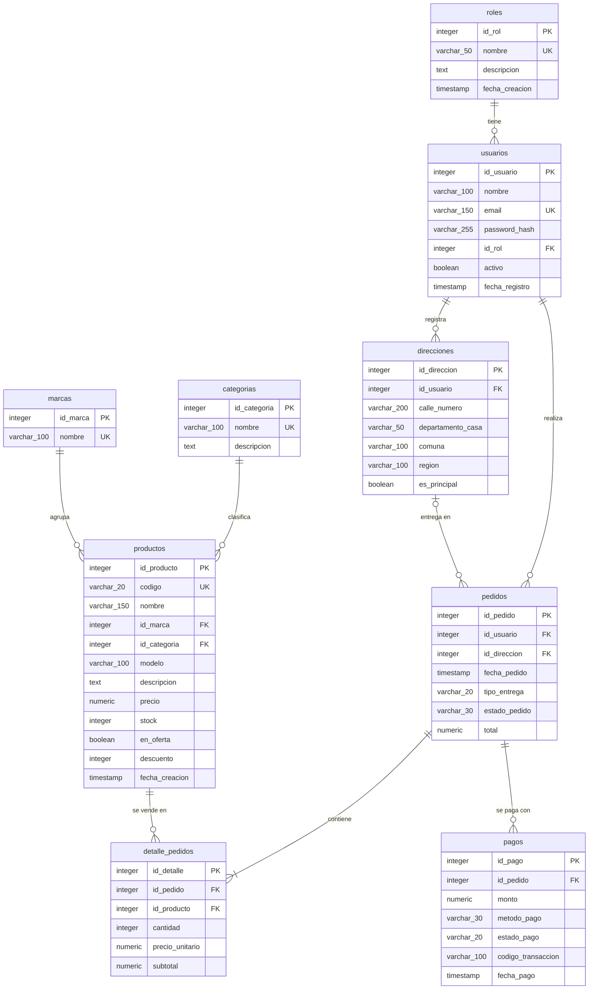
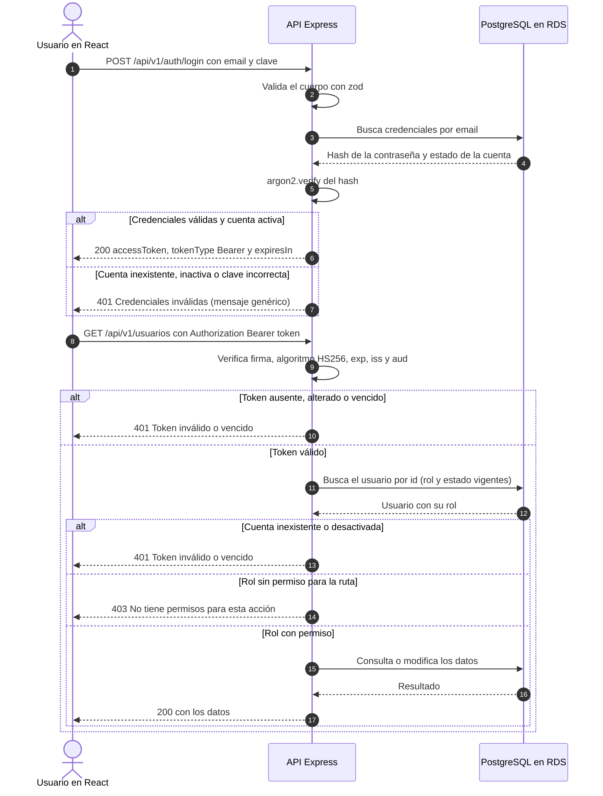

# JOMATE · Backend

## Integrantes

- Martin Faundez (ma.faundezd@duocuc.cl)
- Joaquín Orellana (joa.orellanag@duocuc.cl)
- Vicente Vega (vi.vegaa@duocuc.cl)

## Caso

Sonido Vivo

## Descripción del caso

Tienda en línea dedicada a la venta de instrumentos musicales y accesorios de audio. Este repositorio contiene el backend: una API REST con base de datos PostgreSQL, autenticación con JWT y roles (Administrador, Vendedor y Cliente).

## Repositorios

- Frontend (React): https://github.com/mwrtinn/Proyecto-Semestral-SonidoVivo
- Backend (este repositorio): https://github.com/mwrtinn/SonidoVivo-backend

## Estructura del proyecto

```
├── docs/
│   └── openapi.yaml
├── scripts/
│   └── probar-api.sh
├── sql/
│   ├── schema.sql
│   └── seed.sql
├── src/
│   ├── controllers/
│   │   ├── auth.controller.js
│   │   └── usuarios.controller.js
│   ├── db/
│   │   └── pool.js
│   ├── dto/
│   │   ├── auth.dto.js
│   │   └── usuarios.dto.js
│   ├── middlewares/
│   │   ├── auth.middleware.js
│   │   └── errorHandler.js
│   ├── repositories/
│   │   └── usuarios.repository.js
│   ├── routes/
│   │   ├── auth.routes.js
│   │   ├── index.js
│   │   └── usuarios.routes.js
│   ├── services/
│   │   └── auth.service.js
│   ├── utils/
│   │   ├── AppError.js
│   │   └── asyncHandler.js
│   └── app.js
├── .env.example
├── .gitignore
├── package.json
├── README.md
└── server.js
```

Cada capa tiene una sola responsabilidad: las **rutas** reciben la solicitud, los **controladores** devuelven el estado HTTP, los **servicios** aplican las reglas de negocio (hash, emisión y verificación del JWT), los **repositorios** ejecutan el SQL, los **DTO** validan lo que entra y los **middlewares** autentican y autorizan.

## Tecnologías

- Node.js 24 + Express 5
- PostgreSQL en Amazon RDS (acceso solo desde la VPC)
- Amazon EC2 (ejecución del backend)
- pg (acceso a datos con consultas parametrizadas)
- zod (validación de los datos de entrada)
- argon2 (hash de contraseñas) y jsonwebtoken (JWT)
- helmet y cors (cabeceras de seguridad y orígenes permitidos)
- OpenAPI 3 (documentación de la API)

## Cómo ejecutar el proyecto

Requisitos: Node 24 y una base PostgreSQL accesible.

1. Clonar el repositorio: `git clone https://github.com/mwrtinn/SonidoVivo-backend.git` y entrar a la carpeta.
2. Instalar las dependencias: `npm ci`
3. Crear el archivo de configuración: `cp .env.example .env` y completar `DB_HOST`, `DB_USER`, `DB_PASSWORD` y `JWT_SECRET`.
4. Crear las tablas y los roles: `psql "<cadena de conexión>" -f sql/schema.sql -f sql/seed.sql`
5. Iniciar el servidor: `npm start`

`JWT_SECRET` debe tener al menos 32 caracteres; se puede generar con `openssl rand -hex 32`. `CORS_ORIGINS` debe contener el origen exacto del frontend (protocolo, host y puerto); sin esa variable el navegador no puede llamar a la API. No se suben al repositorio el `.env` ni ninguna credencial.

El registro público siempre crea un Cliente. El primer Administrador se crea promoviendo un usuario ya registrado:

```sql
UPDATE usuarios SET id_rol = (SELECT id_rol FROM roles WHERE nombre = 'Administrador') WHERE email = 'correo@ejemplo.cl';
```

## Estado del trabajo

| Operación | Estado | Cómo se probó |
|---|---|---|
| Tabla de usuarios y roles | Listo | `sql/schema.sql` aplicado en RDS; los datos persisten al reiniciar el backend |
| Registro | Listo | `POST /api/v1/auth/register`: 201, 409 (email repetido) y 400 (datos inválidos) |
| Inicio de sesión | Listo | `POST /api/v1/auth/login`: 200 con JWT y 401 con mensaje genérico |
| Rutas protegidas con JWT | Listo | `GET /api/v1/auth/me`: 200 con token válido; 401 sin token y con token alterado |
| Listar usuarios | En avance | Implementado (solo Administrador); pruebas de permisos pendientes de ejecutar |
| Modificar usuario | En avance | Implementado (cada persona edita lo suyo; el Administrador, rol y estado); pruebas pendientes |
| Eliminar o desactivar usuario | En avance | Implementado como borrado lógico (`activo = false`); pruebas pendientes |
| Swagger / OpenAPI | En avance | Especificación escrita en `docs/openapi.yaml`; falta montar Swagger UI |
| Catálogo y pedidos | Pendiente | Diseñados, sin código |

**Diseñado** significa que está planificado en este README. **Implementado** significa que hay código. **Probado** significa que se ejecutó y su resultado quedó registrado.

## Decisiones técnicas

- **Backend:** Node.js con Express en una instancia EC2. Se reutiliza el trabajo de la guía 18 y se comparte lenguaje con el frontend React.
- **Por qué EC2 y no Lambda:** ya se probaron ambas en la guía 18. Para una API con autenticación, roles y varias rutas, Express en EC2 mantiene un solo proceso y una sola base de código. Lambda exigiría API Gateway, asociar las funciones a la VPC de la base, administrar conexiones por invocación y repartir la verificación del JWT entre funciones, sin aportar valor a una API de este tamaño.
- **Base de datos:** PostgreSQL en Amazon RDS, privada (sin acceso público). Se eligió un motor relacional por las claves foráneas, restricciones y transacciones que necesitan los pedidos y el stock.
- **Acceso a datos:** paquete `pg` con un pool de conexiones y consultas parametrizadas (`$1`, `$2`), para evitar inyección SQL.
- **Validación:** `zod`. Los DTO de entrada descartan campos no permitidos (por ejemplo, un `rol` enviado en el registro).
- **Contraseñas:** `argon2id`. OWASP lo recomienda como primera opción para almacenar contraseñas, por ser costoso en memoria y resistente a ataques con GPU.
- **Contrato en español:** los campos se llaman `nombre`, `email` y `clave`, igual que en el formulario del frontend. La clave exige un mínimo de 8 caracteres y esa misma regla debe aplicar el frontend.
- **Cabeceras y CORS:** `helmet`, y CORS limitado a los orígenes definidos en `CORS_ORIGINS`.

## Diseño de datos

Diagrama entidad-relación. Están **implementadas** `roles` y `usuarios`; el resto está **diseñado** y pendiente.



**Decisiones del modelo**

- Los identificadores son `integer GENERATED ALWAYS AS IDENTITY`; el servidor los asigna, el cliente nunca los envía.
- `usuarios.email` es único y se guarda siempre en minúsculas (restricción CHECK), para que `Ana@x.cl` y `ana@x.cl` no sean cuentas distintas.
- `usuarios.id_rol` usa `ON DELETE RESTRICT`: no se puede borrar un rol que tenga usuarios.
- Los usuarios no se eliminan: se desactivan (`activo = false`), porque los pedidos futuros deben conservar a quién pertenecen.
- `numeric` es `numeric(12,2)` en `precio`, `total`, `subtotal` y `monto`.
- `detalle_pedidos.precio_unitario` guarda el precio del momento de la compra; el servidor lo toma de la tabla de productos y no del cliente.
- Pendiente de decidir: el teléfono de contacto del pedido, que el checkout del frontend ya pide y el modelo aún no tiene.

## API

Rutas versionadas bajo `/api/v1`. La especificación completa está en `docs/openapi.yaml`.

| Método y ruta | Acceso | Respuestas | Estado |
|---|---|---|---|
| `GET /health` | Público | 200 | Implementada |
| `POST /auth/register` | Público; el rol inicial siempre es Cliente | 201, 400, 409 | Implementada y probada |
| `POST /auth/login` | Público | 200, 400, 401 | Implementada y probada |
| `GET /auth/me` | Cualquier usuario autenticado | 200, 401 | Implementada y probada |
| `GET /usuarios` | Administrador | 200, 401, 403 | Implementada |
| `PATCH /usuarios/:id` | Cada persona edita su nombre; el Administrador también rol y estado | 200, 400, 401, 403, 404, 409 | Implementada |
| `DELETE /usuarios/:id` | Administrador; desactiva la cuenta | 204, 401, 403, 404, 409 | Implementada |

Ejemplos con datos ficticios. Lo que envía el cliente es `nombre`, `email` y `clave`; el servidor genera `id_usuario`, `rol`, `activo` y `fecha_registro`.

```json
POST /api/v1/auth/register
{ "nombre": "Ana Prueba", "email": "ana@ejemplo.cl", "clave": "Clave12345" }

201
{ "id_usuario": 1, "nombre": "Ana Prueba", "email": "ana@ejemplo.cl", "rol": "Cliente", "activo": true, "fecha_registro": "2026-11-19T15:00:00.000Z" }
```

```json
POST /api/v1/auth/login
{ "email": "ana@ejemplo.cl", "clave": "Clave12345" }

200
{ "accessToken": "<jwt>", "tokenType": "Bearer", "expiresIn": "1h" }
```

Los errores tienen la forma `{ "mensaje": "...", "detalles": [] }`. Nunca se devuelve la contraseña ni su hash.

### Relación con el frontend

| Pantalla del frontend | Endpoint | Entidades |
|---|---|---|
| Registro | `POST /auth/register` | usuarios, roles |
| Inicio de sesión | `POST /auth/login` | usuarios |
| Recuperar la sesión al recargar la página | `GET /auth/me` | usuarios, roles |
| Administración de usuarios | `GET /usuarios`, `PATCH /usuarios/:id`, `DELETE /usuarios/:id` | usuarios, roles |
| Catálogo, detalle y pedidos | Pendientes | productos, marcas, categorias, pedidos |

## Seguridad

Diagrama de secuencia del inicio de sesión y de una solicitud posterior a una ruta protegida. Las credenciales deben viajar por HTTPS; hoy la API se sirve por HTTP en el laboratorio (ver limitaciones).



- **Registro:** el servidor asigna el rol Cliente; un usuario no puede registrarse como administrador.
- **Login:** ante credenciales incorrectas, cuenta inexistente o cuenta inactiva responde el mismo `401`. Se verifica un hash ficticio cuando el usuario no existe, para que el tiempo de respuesta no delate qué emails están registrados.
- **JWT:** firmado con HS256. Incluye `sub` (id de usuario), `exp`, `iss`, `aud` y el rol. Vigencia de 1 hora; no hay refresh token en esta etapa, así que al vencer se vuelve a iniciar sesión. El secreto está en el `.env`, fuera del repositorio.
- **Verificación:** se comprueban firma, algoritmo permitido (solo HS256), expiración, emisor y destinatario. Además, en cada solicitud se consulta la base para tomar el rol y el estado vigentes y no los del token: una cuenta desactivada o con otro rol pierde el acceso de inmediato aunque conserve un token. Un token ya emitido no se puede revocar antes de que venza, salvo desactivando la cuenta.
- **Roles y permisos:** solo el Administrador lista usuarios, cambia roles y desactiva cuentas. Cada persona puede modificar solo su propio nombre; cambiar el id en la URL devuelve `403`.

**Pendiente o con limitación:**

- Límite de intentos de login (rate limiting).
- La conexión a RDS usa SSL con `rejectUnauthorized: false`: cifra, pero no valida el certificado del servidor.
- La API se sirve por HTTP; en producción debe ir tras HTTPS.
- Dónde guardar el token en el frontend y cómo persiste la sesión al recargar: por definir con el equipo.

**Fuentes consultadas**

- OWASP, Password Storage Cheat Sheet: https://cheatsheetseries.owasp.org/cheatsheets/Password_Storage_Cheat_Sheet.html
- OWASP, REST Security Cheat Sheet: https://cheatsheetseries.owasp.org/cheatsheets/REST_Security_Cheat_Sheet.html
- RFC 7519, JSON Web Token: https://datatracker.ietf.org/doc/html/rfc7519
- node-postgres: https://node-postgres.com/

## Pruebas

Con la API encendida: `bash scripts/probar-api.sh`. Si se define `ADMIN_EMAIL` y `ADMIN_CLAVE` (un usuario promovido a Administrador), el script también prueba las rutas de administración.

| Caso | Resultado esperado | Estado |
|---|---|---|
| Registro válido, aunque se envíe `"rol": "Administrador"` | 201; queda como Cliente | Probado |
| Registro con email repetido | 409 | Probado |
| Registro con datos inválidos | 400 con detalles | Probado |
| Login correcto | 200 con `accessToken` | Probado |
| Login con clave incorrecta o email inexistente | 401, mismo mensaje en ambos | Probado |
| `/auth/me` con token válido, sin token y con token alterado | 200, 401 y 401 | Probado |
| Cliente intenta listar usuarios | 403 | Pendiente de ejecutar |
| Cliente modifica a otra persona cambiando el id | 403 | Pendiente de ejecutar |
| Cliente intenta cambiarse el rol | 403 | Pendiente de ejecutar |
| Administrador lista, cambia roles y desactiva | 200 y 204 | Pendiente de ejecutar |
| Usuario desactivado intenta iniciar sesión o usar su token | 401 | Pendiente de ejecutar |
| Token vencido | 401 | Pendiente (requiere `JWT_EXPIRES_IN` corto) |

## Checklist de la guía 19

- [x] Repositorio nuevo para el backend, separado del frontend.
- [x] El README identifica proyecto, caso, alcance e integrantes.
- [x] El README del backend enlaza al frontend.
- [ ] El README del frontend enlaza al backend.
- [x] Tecnología justificada y ejecución en EC2 explicada.
- [x] Base de datos definida y diagrama entidad-relación en el README.
- [x] Responsabilidades del backend y de los integrantes explicadas.
- [x] Estructura, conexión a datos y primeros endpoints, con su estado real.
- [ ] API documentada con Swagger UI (la especificación está escrita; falta montarla).
- [x] Operaciones de la API relacionadas con las pantallas del frontend.
- [x] Protección de contraseñas investigada y justificada, con fuentes.
- [x] Flujo JWT y permisos diseñados; controles implementados y pendientes distinguidos.
- [x] Diagrama de secuencia propio, con los casos de rechazo.
- [ ] Pruebas de roles y permisos ejecutadas y registradas.
- [x] Instrucciones para ejecutar y comprobar lo construido.
- [ ] Todos los integrantes pueden explicar el código y el avance.

## Material complementario

Carpeta de Drive con documentos del semestre (ERS y otros): (https://drive.google.com/drive/folders/1jpA6YnjLhmLvg1iVfjsRrCLfc4RPS3vU?usp=drive_link)

---

## 👥 Bitácora de Desarrollo y Aportes del Equipo

El backend se reparte por funcionalidad completa, desde la ruta hasta la base de datos, para que cada integrante pueda explicar su parte de punta a punta. El detalle se actualiza con el historial de commits de cada entrega.

- **Martín Faundez (`mwrtinn`)**

  * **Base de datos:** instancia PostgreSQL en Amazon RDS privada, grupos de seguridad, `schema.sql` y `seed.sql` con las tablas `roles` y `usuarios`.
  * **Estructura base:** repositorio, capas (rutas, controladores, servicios, repositorios, DTO y middlewares), conexión con `pg` y manejador central de errores.
  * **Autenticación:** registro con hash `argon2id`, login con JWT (HS256, `iss`, `aud` y vigencia), middleware de verificación y ruta `/auth/me`.
  * **Usuarios:** primera versión de listar, modificar y desactivar con control de rol y propiedad.
  * **Calidad y documentación:** script de pruebas `probar-api.sh`, especificación OpenAPI, diagramas ER y de secuencia y este README.

- **Joaquín Orellana (`CIGGY-1`)**

  * *

- **Vicente Vega (`vishoyo`)**

  * *
